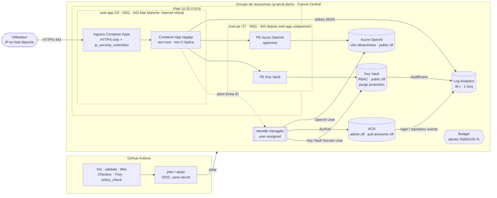

# Architecture

## Flux de confiance

| Flux | Authentification | Réseau |
|---|---|---|
| Utilisateur → app | clé d'API optionnelle (`X-API-Key`, valeur en Key Vault) | HTTPS, liste blanche IP (ingress + NSG) |
| App → Key Vault | identité managée, rôle *Key Vault Secrets User* | point de terminaison privé, DNS privé |
| App → Azure OpenAI | identité managée, rôle *Cognitive Services OpenAI User*, clés désactivées | point de terminaison privé |
| Plateforme → ACR (pull) | identité managée, rôle *AcrPull* | public authentifié (Basic) ou privé (Premium) |
| GitHub → Azure | OIDC fédéré, aucun secret stocké | Internet (API ARM) |
| Terraform → état | Entra ID (`use_azuread_auth`), pas de clé de compte | Internet (à restreindre) |

## Choix et alternatives

- **Container Apps** plutôt qu'App Service : facturation à l'usage avec zéro réplica, références Key Vault natives, injection VNet.
- **Identité user-assigned** : les rôles sont attribués avant le premier démarrage (pas de course entre création de l'app et droits).
- **Secrets hors Terraform** : la valeur d'un `azurerm_key_vault_secret` finit dans l'état en clair. Ici l'état ne contient aucun secret applicatif.
- **Variante 100 % privée** : `internal_only = true` + `acr_sku = "Premium"` ; l'accès passe alors par un VPN / Bastion (non inclus).
